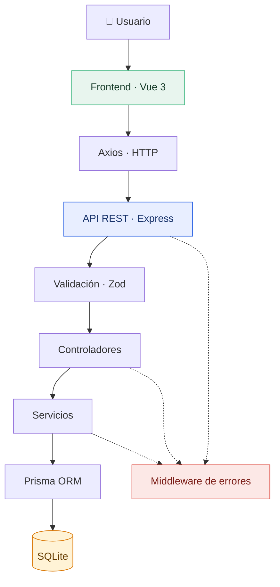

# 👥 Gestor de Clientes
### Prueba técnica · Desarrollo Full Stack

Aplicación web para la gestión de clientes mediante operaciones CRUD (*Crear, Consultar, Actualizar y Eliminar*), desarrollada como prueba técnica para **Miva, parte de Muebles América**.

La solución combina una API REST con una interfaz web reactiva, persistencia en SQLite y validación de datos en ambas capas. La arquitectura prioriza la separación de responsabilidades, la claridad del código y una configuración sencilla para ejecutar el proyecto localmente.

<p align="center">
  
  
  
  
</p>

---

## 📌 Contenido

- [Funcionalidades](#-funcionalidades)
- [Tecnologías](#-tecnologías)
- [Arquitectura](#️-arquitectura)
- [Requisitos previos](#️-requisitos-previos)
- [Instalación y ejecución](#-instalación-y-ejecución)
- [Modelo de datos](#️-modelo-de-datos)
- [API REST](#-api-rest)
- [Validación y manejo de errores](#-validación-y-manejo-de-errores)
- [Decisiones técnicas](#-decisiones-técnicas)
- [Estructura del proyecto](#-estructura-del-proyecto)
- [Autor](#-autor)

## ✨ Funcionalidades

| Funcionalidad | Descripción |
|:--|:--|
| 📋 **Consulta** | Visualización de los clientes registrados. |
| ➕ **Registro** | Alta de clientes con validación de campos obligatorios. |
| ✏️ **Actualización** | Edición de la información de clientes existentes. |
| 🗑️ **Eliminación** | Eliminación de registros con confirmación previa. |
| 🔎 **Búsqueda** | Filtrado por nombre completo, correo electrónico o empresa. |
| 🛡️ **Validación** | Validación de datos en el frontend y el backend. |
| 📧 **Integridad** | Restricción de correos electrónicos duplicados. |
| 💾 **Persistencia** | Almacenamiento de información en una base de datos SQLite. |
| ⚠️ **Manejo de errores** | Tratamiento centralizado de errores de validación y persistencia. |

## 🧰 Tecnologías

<details open>
<summary><strong>Frontend · Interfaz de usuario</strong></summary>

| Tecnología | Uso |
|:--|:--|
| Vue 3 | Construcción de interfaces reactivas. |
| Composition API | Organización de la lógica de los componentes. |
| TypeScript | Tipado estático y mayor claridad en el código. |
| Vite | Servidor de desarrollo y compilación. |
| Axios | Comunicación HTTP con la API. |

</details>

<details open>
<summary><strong>Backend · API y persistencia</strong></summary>

| Tecnología | Uso |
|:--|:--|
| Node.js | Entorno de ejecución. |
| TypeScript | Desarrollo tipado del servidor. |
| Express.js | Enrutamiento y middleware HTTP. |
| Prisma ORM | Acceso a datos y gestión de migraciones. |
| SQLite | Base de datos relacional local. |
| Zod | Validación de datos recibidos por la API. |

</details>

## 🏗️ Arquitectura

El proyecto separa la interfaz, el procesamiento de solicitudes, la lógica de negocio y la persistencia. Esta organización permite mantener cada responsabilidad en su capa correspondiente, sin introducir complejidad innecesaria para el alcance de la prueba.



**Flujo general:** el usuario realiza una acción desde la interfaz; Axios envía la solicitud a Express; los datos se validan y la lógica correspondiente se ejecuta mediante los servicios y Prisma. Finalmente, la API devuelve una respuesta JSON o delega el error al middleware centralizado.

## ⚙️ Requisitos previos

Antes de ejecutar el proyecto, asegúrate de contar con:

- [Node.js](https://nodejs.org/) — versión compatible con las dependencias instaladas.
- npm — incluido con Node.js.
- [pnpm](https://pnpm.io/installation) — gestor de paquetes del frontend.
- [Git](https://git-scm.com/) — para clonar el repositorio.

Comprueba las versiones instaladas:

```bash
node --version
npm --version
pnpm --version
git --version
```

Si necesitas habilitar pnpm mediante Corepack y tu instalación lo admite:

```bash
corepack enable
corepack prepare pnpm@latest --activate
```

## 🚀 Instalación y ejecución

El frontend y el backend se ejecutan por separado. Sigue los pasos en orden y mantén ambas terminales abiertas durante el uso de la aplicación.

### 1. Clonar el repositorio

```bash
git clone <URL_DEL_REPOSITORIO>
cd gestor-clientes
```

Sustituye `<URL_DEL_REPOSITORIO>` por la dirección real del repositorio.

### 2. Configurar el backend

Desde la raíz del proyecto, accede a la carpeta del servidor:

```bash
cd server
npm install
```

Crea el archivo `server/.env` con la siguiente configuración:

```env
DATABASE_URL="file:./dev.db"
PORT=3000
```

#### Inicializar la base de datos

Genera el cliente de Prisma y aplica las migraciones:

```bash
npx prisma generate
npx prisma migrate dev --name init
```

La primera instrucción genera el cliente de acceso a datos. La segunda aplica la migración inicial y prepara el esquema de SQLite según la configuración del proyecto.

> Si el repositorio ya contiene una migración inicial, puedes conservar el nombre de esa migración en lugar de crear otra innecesariamente.

#### Iniciar el servidor

```bash
npm run dev
```

El backend estará disponible en:

`http://localhost:3000`

### 3. Configurar el frontend

Abre una segunda terminal y accede a la carpeta del cliente:

```bash
cd client
pnpm install
```

Crea el archivo `client/.env`:

```env
VITE_API_URL=http://localhost:3000
```

Esta variable establece la dirección base de la API utilizada por Axios.

Inicia el servidor de desarrollo:

```bash
pnpm run dev
```

Por defecto, Vite sirve la aplicación en:

`http://localhost:5173`

### 4. Verificar el funcionamiento

Abre la dirección del frontend en tu navegador y comprueba los siguientes escenarios:

- Consultar los clientes registrados.
- Crear un cliente con información válida.
- Intentar enviar un formulario incompleto o un correo inválido.
- Editar la información de un cliente.
- Buscar por nombre, correo electrónico o empresa.
- Eliminar un registro y confirmar la acción.
- Intentar registrar un correo electrónico que ya exista.

### 🧩 Solución de problemas frecuentes

| Problema | Qué revisar |
|:--|:--|
| `pnpm` no se reconoce | Instala o activa pnpm y reinicia la terminal. |
| Error de conexión con SQLite | Revisa `DATABASE_URL` y la ruta definida en Prisma. |
| Error al generar Prisma Client | Ejecuta `npx prisma generate` desde `server/`. |
| No existe la tabla `clientes` | Comprueba que las migraciones estén presentes y ejecutadas. |
| El frontend no conecta con la API | Verifica `VITE_API_URL` y que el backend esté activo. |
| El puerto está ocupado | Libera el puerto o configura uno diferente. |

## 🗄️ Modelo de datos

La entidad `Cliente` representa la información de contacto y empresa de cada registro.

| Campo en Prisma | Columna en SQLite | Tipo | Restricciones |
|:--|:--|:--|:--|
| `id` | `id` | String | UUID autogenerado, clave primaria. |
| `nombreCompleto` | `nombre_completo` | String | Obligatorio. |
| `email` | `email` | String | Obligatorio y único. |
| `telefono` | `telefono` | String | Opcional. |
| `empresa` | `empresa` | String | Obligatorio. |
| `creadoEn` | `creado_en` | DateTime | Se inicializa automáticamente. |
| `actualizadoEn` | `actualizado_en` | DateTime | Se actualiza mediante Prisma. |

### Convención de nombres: `camelCase` y `snake_case`

Se utiliza el mapeo explícito de Prisma para separar los nombres de los campos en el código de los nombres físicos de las columnas en la base de datos.

```prisma
model Cliente {
  id             String   @id @default(uuid())
  nombreCompleto String   @map("nombre_completo")
  email          String   @unique
  telefono       String?
  empresa        String
  creadoEn       DateTime @default(now()) @map("creado_en")
  actualizadoEn  DateTime @updatedAt @map("actualizado_en")

  @@map("clientes")
}
```

**¿Qué aporta esta decisión?**

- **`camelCase` en la aplicación:** permite utilizar nombres idiomáticos de TypeScript, como `nombreCompleto`, `creadoEn` y `actualizadoEn`.
- **`snake_case` en la base de datos:** mantiene nombres de columnas consistentes, como `nombre_completo`, `creado_en` y `actualizado_en`.
- **`@@map("clientes")`:** vincula el modelo `Cliente` con la tabla física `clientes`.
- **`@unique`:** establece una restricción de unicidad para el correo electrónico.
- **Fechas automáticas:** `@default(now())` inicializa la fecha de creación y `@updatedAt` actualiza la fecha de modificación mediante Prisma.

El mapeo evita propagar convenciones propias de la base de datos a toda la aplicación y mantiene clara la separación entre el modelo de datos utilizado en TypeScript y su representación en SQLite.

## 🔌 API REST

La API expone las siguientes operaciones para administrar los clientes:

| Método | Endpoint | Descripción |
|:--|:--|:--|
| `GET` | `/api/clientes` | Consultar todos los clientes. |
| `GET` | `/api/clientes/:id` | Consultar un cliente por su identificador. |
| `POST` | `/api/clientes` | Crear un nuevo cliente. |
| `PUT` | `/api/clientes/:id` | Actualizar un cliente existente. |
| `DELETE` | `/api/clientes/:id` | Eliminar un cliente. |

### Ejemplo de creación

**Solicitud**

```http
POST /api/clientes
Content-Type: application/json
```

```json
{
  "nombreCompleto": "María Fernanda López",
  "email": "maria.lopez@example.com",
  "telefono": "3312345678",
  "empresa": "Empresa Demo"
}
```

**Ejemplo de respuesta**

```json
{
  "id": "550e8400-e29b-41d4-a716-446655440000",
  "nombreCompleto": "María Fernanda López",
  "email": "maria.lopez@example.com",
  "telefono": "3312345678",
  "empresa": "Empresa Demo",
  "creadoEn": "2026-10-28T18:00:00.000Z",
  "actualizadoEn": "2026-10-28T18:00:00.000Z"
}
```

*Los datos de la respuesta son ilustrativos. El cuerpo definitivo y el código HTTP dependen de la implementación de la API.*

## 🛡️ Validación y manejo de errores

La validación se realiza en dos niveles complementarios.

**Frontend**

- Comprueba los campos obligatorios antes de enviar el formulario.
- Valida el formato del correo electrónico.
- Proporciona retroalimentación inmediata al usuario.

**Backend**

- Valida los datos recibidos mediante Zod.
- No depende de las validaciones ejecutadas en el navegador.
- Gestiona las restricciones de persistencia, como los correos duplicados.
- Centraliza el tratamiento de errores para mantener respuestas consistentes.

La validación del cliente mejora la experiencia de uso; la validación del servidor protege la integridad de los datos incluso cuando las solicitudes se realizan fuera de la interfaz.

## 🧠 Decisiones técnicas

### 1. Arquitectura modular

Las funcionalidades relacionadas con clientes se agrupan en un módulo específico. Esto facilita localizar el código, mantener cada responsabilidad y añadir futuras funcionalidades sin concentrar toda la lógica en un único archivo.

### 2. Separación de responsabilidades

Los controladores gestionan el contexto HTTP, mientras que los servicios concentran la lógica de negocio y coordinan las operaciones de datos mediante Prisma. Esta separación facilita el mantenimiento y permite probar las responsabilidades de forma más aislada.

### 3. Validación en ambas capas

El frontend valida antes de enviar los datos para mejorar la experiencia de uso. El backend vuelve a validar las solicitudes mediante Zod porque no debe confiar en la información recibida del cliente.

### 4. Manejo centralizado de errores

Un middleware común permite tratar errores de validación, restricciones conocidas de la base de datos y fallos inesperados en un punto central. Esto reduce la duplicación de código y favorece respuestas HTTP coherentes.

### 5. Mapeo explícito de nombres en Prisma

Las directivas `@map` y `@@map` permiten mantener `camelCase` en el código y `snake_case` en SQLite. Esta solución resuelve la diferencia entre convenciones sin añadir transformaciones manuales en cada operación.

### 6. Composables de Vue 3

Los composables encapsulan lógica reactiva reutilizable, como la administración de clientes y las notificaciones. Para el alcance de esta prueba, este enfoque evita incorporar una librería de estado global si no resulta necesaria.

### 7. SQLite y configuración sencilla

SQLite cumple el requisito de utilizar una base de datos local sin depender de servicios externos. Prisma gestiona el acceso a los datos y las migraciones, lo que facilita reproducir el entorno de desarrollo.

**Criterio general:** priorizar una solución clara, mantenible y suficiente para los requisitos de la prueba, evitando complejidad arquitectónica que no aporte valor al alcance actual.

## 📁 Estructura del proyecto

```text
gestor-clientes/
│
├── server/                         # API REST
│   ├── prisma/
│   │   ├── migrations/              # Historial de migraciones
│   │   └── schema.prisma            # Modelo y configuración de datos
│   │
│   ├── src/
│   │   ├── modules/
│   │   │   └── clientes/            # Funcionalidad de clientes
│   │   ├── middlewares/             # Middleware compartido
│   │   └── utils/                   # Utilidades generales
│   │
│   ├── .env.example
│   └── package.json
│
├── client/                          # Interfaz web
│   ├── src/
│   │   ├── components/              # Componentes reutilizables
│   │   ├── composables/             # Lógica reactiva compartida
│   │   ├── services/                # Comunicación con la API
│   │   └── types/                   # Tipos de TypeScript
│   │
│   ├── .env.example
│   └── package.json
│
├── .gitignore
└── README.md
```

*La estructura es ilustrativa: conserva únicamente los directorios y archivos que existan en la versión entregada.*

## 🔐 Variables de entorno

Incluye archivos de ejemplo para documentar la configuración necesaria sin exponer datos locales.

**`server/.env.example`**

```env
DATABASE_URL="file:./dev.db"
PORT=3000
```

**`client/.env.example`**

```env
VITE_API_URL=http://localhost:3000
```

Los archivos `.env` reales deben excluirse del repositorio mediante `.gitignore`. Conserva las migraciones de Prisma en el control de versiones para que otros desarrolladores puedan reproducir el esquema de la base de datos.

## 👨‍💻 Autor

**Axel Emmanuel Chagollán Corona**

Ingeniero en Computación · Desarrollador de Software

Proyecto desarrollado como prueba técnica para **Miva, parte de Muebles América**.

[](https://github.com/axelchagollan07)

---

<p align="center">
  <sub>Desarrollado con Vue 3 · TypeScript · Node.js · Express · Prisma · SQLite</sub>
</p>