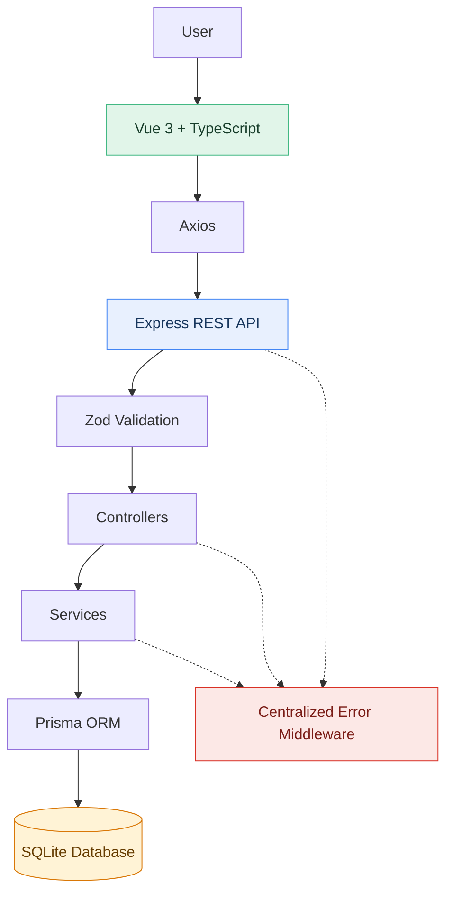

# Gestor de Clientes
### Full Stack CRUD Application

Aplicación web full stack para la gestión de clientes, desarrollada como prueba técnica para **Miva, parte de Muebles América**. Implementa las operaciones CRUD (*Create, Read, Update, Delete*) mediante una API REST y una interfaz web reactiva, con persistencia en SQLite, validación de datos y separación de responsabilidades entre frontend y backend.

El proyecto prioriza una arquitectura modular, decisiones técnicas pragmáticas y una configuración sencilla de desarrollo, de acuerdo con los objetivos de la prueba.

<p align="left">
  
  
  
  
  
  
  
</p>

---

## Table of contents

- [Features](#features)
- [Technology stack](#technology-stack)
- [Architecture](#architecture)
- [Prerequisites](#prerequisites)
- [Installation and setup](#installation-and-setup)
- [Data model and database mapping](#data-model-and-database-mapping)
- [REST API](#rest-api)
- [Validation and error handling](#validation-and-error-handling)
- [Technical decisions](#technical-decisions)
- [Project structure](#project-structure)
- [Author](#author)

## Features

- **Client listing:** retrieve and display registered clients.
- **Client creation:** register clients with required fields and email validation.
- **Client editing:** update the information of an existing client.
- **Client deletion:** remove a client with a confirmation step.
- **Client search:** filter clients by full name, email address, or company.
- **Data validation:** validate input in the frontend and enforce validation rules in the backend.
- **Duplicate email prevention:** enforce email uniqueness through the database schema and handle conflicts appropriately.
- **Persistent storage:** store client records in a local SQLite database.
- **Centralized error handling:** maintain consistent error responses across the API.

## Technology stack

| Layer | Technology | Purpose |
|:--|:--|:--|
| Runtime | Node.js | JavaScript execution environment |
| Backend language | TypeScript | Static typing and maintainability |
| API framework | Express.js | HTTP routing and middleware |
| ORM | Prisma | Database access, schema definition and migrations |
| Database | SQLite | Local relational persistence |
| Validation | Zod | Runtime validation of incoming data |
| Frontend framework | Vue 3 | Reactive user interface |
| Frontend language | TypeScript | Typed components and data contracts |
| Build tooling | Vite | Development server and production builds |
| HTTP client | Axios | Communication with the backend |

## Architecture

The application separates the user interface, HTTP communication, business logic and data persistence. Each layer has a focused responsibility, making the code easier to understand, test and extend.



**Request lifecycle:** the frontend sends an HTTP request through Axios. Express routes the request to the appropriate controller, the incoming data is validated, and the service coordinates the required operation through Prisma. The API then returns a JSON response or forwards the error to the centralized error-handling middleware.

## Prerequisites

Install the following tools before running the application:

- **Node.js:** version 18 or later, subject to compatibility with the project's installed dependencies.
- **npm:** included with Node.js.
- **pnpm:** package manager for the frontend.
- **Git:** required to clone the repository.

Verify your environment:

```bash
node --version
npm --version
pnpm --version
git --version
```

If pnpm is not installed, enable it through Corepack if supported by your Node.js installation:

```bash
corepack enable
corepack prepare pnpm@latest --activate
```

## Installation and setup

The backend and frontend run as separate processes. Keep both development servers running while using the application.

### 1. Clone the repository

```bash
git clone <REPOSITORY_URL>
cd gestor-clientes
```

Replace `<REPOSITORY_URL>` with the actual repository URL.

### 2. Configure the backend

Navigate to the backend directory and install its dependencies:

```bash
cd server
npm install
```

Create a `.env` file inside `server/` with the following configuration:

```env
DATABASE_URL="file:./dev.db"
PORT=3000
```

The database URL configures SQLite. Its relative path must match the database location expected by the Prisma schema.

#### Initialize the database

Generate the Prisma Client and apply the initial migration:

```bash
npx prisma generate
npx prisma migrate dev --name init
```

These commands generate the database client and create or update the SQLite database according to the migration history.

**Start the backend:**

```bash
npm run dev
```

The API should now be available at:

`http://localhost:3000`

> The commands above assume that the backend defines a `dev` script and uses the conventional Prisma development migration workflow. Run the commands from the `server/` directory.

### 3. Configure the frontend

Open a second terminal and navigate to the frontend directory from the project root:

```bash
cd client
pnpm install
```

Create a `.env` file inside `client/`:

```env
VITE_API_URL=http://localhost:3000
```

This variable defines the base URL used by the frontend to communicate with the API.

**Start the frontend:**

```bash
pnpm run dev
```

Vite will display the local URL in the terminal. The default is:

`http://localhost:5173`

### 4. Run the application

Open the frontend URL in your browser while both development servers are running.

Verify the main workflows:

1. View the registered clients.
2. Create a client using the required fields.
3. Attempt to submit invalid or incomplete information and verify the validation feedback.
4. Edit an existing client's information.
5. Search for clients by name, email or company.
6. Delete a client after confirming the action.
7. Verify that duplicate email addresses are rejected.

### Troubleshooting

| Issue | Recommended action |
|:--|:--|
| `pnpm` is not recognized | Install or activate pnpm, then reopen the terminal. |
| Database connection error | Check `DATABASE_URL` and the database path in `schema.prisma`. |
| Prisma Client generation error | Run `npx prisma generate` from `server/`. |
| Database table does not exist | Run `npx prisma migrate dev --name init` from `server/`. |
| Frontend cannot reach the API | Verify the backend is running and check `VITE_API_URL`. |
| Port already in use | Stop the process using the port or configure an available port. |

## Data model and database mapping

The application uses Prisma to define the `Cliente` entity and map it to a relational table in SQLite.

The model contains the following fields:

| Prisma field | SQLite column | Type | Constraints |
|:--|:--|:--|:--|
| `id` | `id` | String | UUID generated automatically; primary key |
| `nombreCompleto` | `nombre_completo` | String | Required |
| `email` | `email` | String | Required and unique |
| `telefono` | `telefono` | String | Optional |
| `empresa` | `empresa` | String | Required |
| `creadoEn` | `creado_en` | DateTime | Automatically initialized |
| `actualizadoEn` | `actualizado_en` | DateTime | Automatically updated |

### Naming conventions: camelCase and snake_case

A deliberate mapping strategy is implemented using Prisma's `@map` and `@@map` attributes.

```prisma
model Cliente {
  id             String   @id @default(uuid())
  nombreCompleto String   @map("nombre_completo")
  email          String   @unique
  telefono       String?
  empresa        String
  creadoEn       DateTime @default(now()) @map("creado_en")
  actualizadoEn  DateTime @updatedAt @map("actualizado_en")

  @@map("clientes")
}
```

This configuration separates the naming conventions used by the application from those used by the database:

- **Application layer — camelCase:** Prisma exposes fields such as `nombreCompleto`, `creadoEn` and `actualizadoEn`, following TypeScript naming conventions.
- **Database layer — snake_case:** the corresponding SQLite columns are named `nombre_completo`, `creado_en` and `actualizado_en`.
- **Table mapping:** `@@map("clientes")` maps the Prisma model `Cliente` to the physical SQLite table `clientes`.
- **Uniqueness:** `@unique` enforces the uniqueness of the email column at the database level.
- **Automatic timestamps:** `@default(now())` initializes the creation timestamp, while `@updatedAt` updates the modification timestamp through Prisma.

**Why this matters:** the mapping preserves readable, idiomatic TypeScript without compromising a consistent database naming convention. It also avoids requiring application code to use database-oriented field names everywhere.

The mapping does not rename the fields exposed by Prisma Client. It defines how Prisma translates model and field names into the corresponding physical database names.

## REST API

The backend exposes a REST API for managing clients.

| Method | Endpoint | Description |
|:--|:--|:--|
| `GET` | `/api/clientes` | Retrieve the list of clients |
| `GET` | `/api/clientes/:id` | Retrieve a client by ID |
| `POST` | `/api/clientes` | Create a new client |
| `PUT` | `/api/clientes/:id` | Update an existing client |
| `DELETE` | `/api/clientes/:id` | Delete a client |

### Example: create a client

**Request**

```http
POST /api/clientes
Content-Type: application/json
```

```json
{
  "nombreCompleto": "María Fernanda López",
  "email": "maria.lopez@example.com",
  "telefono": "3312345678",
  "empresa": "Empresa Demo"
}
```

The request uses the application-facing field names. Prisma maps the relevant fields to their corresponding SQLite columns when persisting the record.

**Example response**

```json
{
  "id": "550e8400-e29b-41d4-a716-446655440000",
  "nombreCompleto": "María Fernanda López",
  "email": "maria.lopez@example.com",
  "telefono": "3312345678",
  "empresa": "Empresa Demo",
  "creadoEn": "2026-10-28T18:00:00.000Z",
  "actualizadoEn": "2026-10-28T18:00:00.000Z"
}
```

*The response is illustrative. The actual response body and HTTP status codes depend on the implemented controller and serialization logic.*

## Validation and error handling

The application uses complementary validation mechanisms to protect data integrity and improve the user experience.

### Frontend validation

- Checks required fields before submitting a form.
- Validates the email format.
- Provides feedback when the input is invalid.
- Helps prevent unnecessary requests to the backend.

### Backend validation

- Validates incoming data using Zod.
- Rejects invalid payloads independently of frontend validation.
- Handles database constraints, including duplicate email addresses.
- Uses centralized error handling to keep HTTP error responses consistent.

Frontend validation is primarily a usability feature; backend validation is necessary because clients can send requests without using the interface.

## Technical decisions

### 1. Modular backend architecture

The backend organizes functionality by domain, with the client-management module grouping the relevant routes, controllers, services and validation schemas.

This keeps related functionality together and makes the codebase easier to extend without introducing unnecessary architectural layers.

### 2. Separation of concerns

Controllers handle HTTP-specific responsibilities, while services encapsulate business logic and coordinate data operations through Prisma.

This separation improves readability and makes individual responsibilities easier to test and maintain.

### 3. Validation at the API boundary

Zod validates incoming data before it reaches the business logic. The frontend performs complementary validation for immediate feedback, but the backend remains responsible for enforcing the rules of the API.

### 4. Centralized error handling

A shared error-handling middleware provides a consistent place to translate validation errors, known database errors and unexpected failures into appropriate HTTP responses.

This avoids scattering error-handling logic throughout individual controllers and routes.

### 5. Prisma field and table mapping

The `@map` and `@@map` attributes explicitly separate application naming from database naming. This preserves camelCase in the TypeScript layer and snake_case in SQLite, making the conventions clear without adding manual mapping logic throughout the application.

### 6. Composables instead of a global state library

Vue 3 composables encapsulate reusable reactive logic, such as client operations and notifications. For the scope of this application, this approach avoids the additional configuration and dependencies of a global state-management library.

### 7. SQLite for straightforward setup

SQLite satisfies the database requirement without requiring a separate database server or container. Prisma manages database access and migrations, keeping the development environment straightforward and reproducible.

The chosen solution focuses on the requirements of the exercise rather than introducing infrastructure that would not provide meaningful value at this stage.

## Project structure

```text
gestor-clientes/
├── server/
│   ├── prisma/
│   │   ├── migrations/
│   │   └── schema.prisma
│   ├── src/
│   │   ├── modules/
│   │   │   └── clientes/
│   │   ├── middlewares/
│   │   └── utils/
│   ├── .env.example
│   └── package.json
│
├── client/
│   ├── src/
│   │   ├── components/
│   │   ├── composables/
│   │   ├── services/
│   │   └── types/
│   ├── .env.example
│   └── package.json
│
├── .gitignore
└── README.md
```

*This tree summarizes the intended organization. Retain only directories and files that exist in the submitted repository.*

## Environment configuration

Commit example environment files, not machine-specific `.env` files.

**`server/.env.example`**

```env
DATABASE_URL="file:./dev.db"
PORT=3000
```

**`client/.env.example`**

```env
VITE_API_URL=http://localhost:3000
```

Ensure that `.gitignore` excludes actual environment files, generated dependencies and local database files where appropriate. The migration files should remain in version control so another developer can reproduce the database schema.

## Author

**Axel Emmanuel Chagollán Corona**

Computer Science Engineer · Full Stack Developer

Developed as a technical assessment for **Miva, part of Muebles América**.

[GitHub — axelchagollan07](https://github.com/axelchagollan07)

---

<sub>Built with Vue 3, TypeScript, Node.js, Express, Prisma and SQLite.</sub>